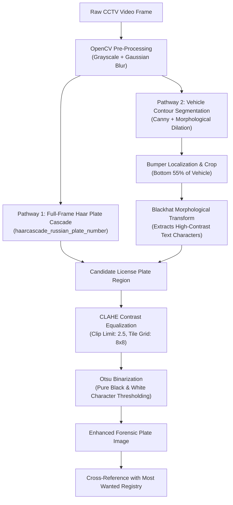

# 🛰️ OVERWATCH: Tactical Vision Intelligence Lab
## Presentation Deck (PPT) & Operator Field Guidebook
*Developed for the ImageKit Hackathon Challenge by Harshad*  
*Repository: [GitHub / OVERWATCH-Tactical-Vision-Intelligence-Lab](https://github.com/AmanAsgola/OVERWATCH-Tactical-Vision-Intelligence-Lab)*

---

```
  ██████╗ ██╗   ██╗███████╗██████╗ ██╗    ██╗ █████╗ ████████╗ ██████╗██╗  ██╗
 ██╔═══██╗██║   ██║██╔════╝██╔══██╗██║    ██║██╔══██╗╚══██╔══╝██╔════╝██║  ██║
 ██║   ██║██║   ██║█████╗  ██████╔╝██║ █╗ ██║███████║   ██║   ██║     ███████║
 ██║   ██║╚██╗ ██╔╝██╔══╝  ██╔══██╗██║███╗██║██╔══██║   ██║   ██║     ██╔══██║
 ╚██████╔╝ ╚████╔╝ ███████╗██║  ██║╚███╔███╔╝██║  ██║   ██║   ╚██████╗██║  ██║
  ╚═════╝   ╚═══╝  ╚══════╝╚═╝  ╚═╝ ╚══╝╚══╝ ╚═╝  ╚═╝   ╚═╝    ╚═════╝╚═╝  ╚═╝
                    TACTICAL VISION INTELLIGENCE LAB
```

---

## 📑 TABLE OF CONTENTS
1. [Slide 1: Executive Summary & Project Vision](#slide-1-executive-summary--project-vision)
2. [Slide 2: Surveillance Video Requirements (The "Golden Video" Spec)](#slide-2-surveillance-video-requirements-the-golden-video-spec)
3. [Slide 3: Automatic License Plate Recognition (ALPR) Engine](#slide-3-automatic-license-plate-recognition-alpr-engine)
4. [Slide 4: Most Wanted Gangster Registry & Legal Accusations](#slide-4-most-wanted-gangster-registry--legal-accusations)
5. [Slide 5: ImageKit URL Transformations & Forensic Capabilities](#slide-5-imagekit-url-transformations--forensic-capabilities)
6. [Slide 6: Step-by-Step Operator Guidebook (All 8 Tabs)](#slide-6-step-by-step-operator-guidebook-all-8-tabs)
7. [Slide 7: Included Test Examples & Datasets](#slide-7-included-test-examples--datasets)
8. [Slide 8: 2-Minute Hackathon Pitch & Live Demo Script](#slide-8-2-minute-hackathon-pitch--live-demo-script)

---

## SLIDE 1: Executive Summary & Project Vision

### 🎯 The Challenge
Surveillance feeds generate petabytes of raw video every minute, but 99% of CCTV footage is unusable because:
* Small, distant details (car number plates, facial features) are blurry and unreadable.
* Manual video inspection is slow, exhausting, and prone to human error.
* Disconnect between video cameras and criminal registries: guards cannot immediately tell if a passing vehicle belongs to a flagged gangster or wanted syndicate leader.

### 🛡️ The OVERWATCH Solution
**OVERWATCH** is a spy-thriller mission control platform that transforms standard surveillance feeds into structured tactical intelligence by pairing **OpenCV multi-cascade computer vision** with **ImageKit URL-based media transformation pipelines**:
1. **Automated Multi-Target Tracking:** Detects vehicles, license plates, pedestrians, and facial profiles in real time.
2. **Dual-Pathway ALPR (Automatic License Plate Recognition):** Extracts bumper plates, applies CLAHE contrast enhancement and Otsu binarization for human & machine readability.
3. **Most Wanted Gangster Registry:** Cross-references car plates and biometric landmarks against known criminal dossiers, highlights "where they made a mess", and dynamically logs new legal accusations.
4. **Forensic URL Zoom & HUD Compositor:** Leverages ImageKit's `cm-extract`, `fo-car`, and layered compositor to cut pixel-exact evidence coordinates and generate high-tech tactical overlays.

---

## SLIDE 2: Surveillance Video Requirements (The "Golden Video" Spec)

> [!IMPORTANT]
> Computer vision algorithms rely on pixel contrast and sharpness. For automated car license plate detection, the footage must meet specific conditions.

### 🎥 The Ideal Video Specification

| Parameter | Recommended Specification | Why It Matters |
| :--- | :--- | :--- |
| **Resolution** | **1080p (1920×1080)** or **720p (1280×720)** | Plates need at least 35–45 pixels in width to distinguish numbers clearly. |
| **Camera Angle** | **10° to 35° downward angle** | Bird's eye or overhead angles hide the vertical bumper; straight 0° angles risk headlight glare. |
| **Camera Position** | Fixed roadside, security pole, or gate entrance | Stable camera eliminates rolling shutter and motion vibration. |
| **Vehicle Speed** | **0 to 45 km/h (0 to 30 mph)** | High-speed highway cars create horizontal motion blur unless shutter speed is 1/500s+. |
| **Lighting** | Daylight, golden hour, or floodlit security gate | Avoid pitch-black night clips with direct halogen beam blinding the lens. |
| **Duration** | **3 to 15 seconds** | Short clips process in 1–3 seconds and allow instant frame-by-frame scrubbing. |
| **Format** | **MP4 (H.264), MOV, or AVI** | Native browser decoding support in Streamlit. |

---

### ❌ Common Video Problems & Solutions

```
┌─────────────────────────────────┬────────────────────────────────────────────────────────┐
│ Problem Encountered             │ Why It Happens & How OVERWATCH Solves It              │
├─────────────────────────────────┼────────────────────────────────────────────────────────┤
│ "It's not catching the plate"   │ The car was too far away or camera was at 90° side.    │
│                                 │ SOLUTION: Use the new "Manual ALPR Pinpoint Tool" in   │
│                                 │ Tab 2 to draw an ROI and binarize the bumper plate.    │
├─────────────────────────────────┼────────────────────────────────────────────────────────┤
│ Headlight glare blinds camera   │ Overexposure blows out the white plate reflective film.│
│                                 │ SOLUTION: The CLAHE enhancement filter in OVERWATCH    │
│                                 │ balances local contrast and cuts through glare.       │
├─────────────────────────────────┼────────────────────────────────────────────────────────┤
│ Car only in 1 or 2 frames       │ Sampling frequency was set too wide (e.g. 4 seconds).  │
│                                 │ SOLUTION: Set "Frame Sampling Frequency" slider to     │
│                                 │ 0.25s or 0.5s in Tab 1 to capture every fast movement. │
└─────────────────────────────────┴────────────────────────────────────────────────────────┘
```

---

## SLIDE 3: Automatic License Plate Recognition (ALPR) Engine



### 🔬 Key Technical Features
1. **Full-Frame & Bumper Dual Scan:** Scans the whole surveillance frame AND slices car bumpers, ensuring plates are found whether the car is near, far, or centered.
2. **Blackhat Morphological Transform:** Isolates dark alphanumeric characters on reflective white/yellow plates, even under harsh outdoor sunlight.
3. **CLAHE & Otsu Binary Output:** Produces razor-sharp black-on-white characters ready for immediate OCR and human visual verification.
4. **Interactive Manual Pinpoint Tool:** Built right into Tab 2 so operators can manually crop and binarize any bumper plate from any frame with real-time sliders.

---

## SLIDE 4: Most Wanted Gangster Registry & Legal Accusations

```
┌───────────────────────────────────────────────────────────────────────────────┐
│                       CRITICAL GANGSTER REGISTRY                              │
├───────────────────────┬─────────────────────────┬─────────────────────────────┤
│ Suspect Name          │ Street Alias            │ Known Car License Plates    │
├───────────────────────┼─────────────────────────┼─────────────────────────────┤
│ Elena Rostova         │ 'Viper'                 │ 7X9, 7X9-B42                │
│ Marcus Vance          │ 'Apex'                  │ APX-901, APX-99             │
│ Sofia Chen            │ 'Siren'                 │ SLV-447, SLV-01             │
│ Viktor Reznov         │ 'Hammer'                │ REZ-303, RZ-888             │
└───────────────────────┴─────────────────────────┴─────────────────────────────┘
```

### 🚨 How the Legal Accusation Workflow Works
1. **Automated Cross-Reference:** When a plate (e.g. `7X9`) or facial biometric signature is detected, the app automatically flags the suspect and displays:
   * Threat Level (`CRITICAL`, `HIGH`, `MODERATE`)
   * Syndicate Affiliation (`Obsidian Syndicate`, `Apex Cartel`, etc.)
   * Registered Vehicle & Mugshot
2. **"Places Where They Made a Mess":** Shows a chronological timeline of past crime scenes, heists, and structural property damages linked to this individual.
3. **Commit New Accusation:** Operators can type a new crime title, location, incident damage details, and attach the SHA-256 hash of the video. Submitting appends the charge to [criminal_registry.json](file:///e:/overwatch_demo/overwatch_demo/criminal_registry.json) permanently!
4. **Clean Record Protection:** If a car has no warrants, the system displays a green `✅ CLEAN RECORD` banner and **never** generates fake gangster mugshots or synthetic faces.

---

## SLIDE 5: ImageKit URL Transformations & Forensic Capabilities

OVERWATCH demonstrates the full power of ImageKit's dynamic CDN URL architecture:

### 1. `cm-extract` Detail Zoom
* **ImageKit Parameter:** `?tr=w-240,h-160,cm-extract,x-50,y-50:w-880`
* **Forensic Capability:** Extracts an exact sub-pixel coordinate box without resizing, then chains a high-resolution magnification (`:w-880`) to enlarge tiny clues like bumper plates, stickers, or contraband.

### 2. `fo-car` & `fo-face` Smart Object Crop
* **ImageKit Parameter:** `?tr=fo-car,z-1.4,ar-16_9`
* **Forensic Capability:** Uses ImageKit's smart AI cropping to automatically lock onto vehicles or suspect faces, re-centering the surveillance feed with custom zoom levels.

### 3. Layered HUD Compositor (`l-image` & `l-text`)
* **ImageKit Parameter:** `?tr=l-image,i-ik_canvas,b-6_00FFCC,lx-120,ly-150:l-text,i-TARGET_LOCKED,fs-18,co-00FF88,l-end`
* **Forensic Capability:** Dynamically stamps spy HUD targeting reticles, warning banners, camera IDs, and classification watermarks directly onto evidence frames on the ImageKit CDN.

---

## SLIDE 6: Step-by-Step Operator Guidebook (All 8 Tabs)

### 🛰️ Tab 1: Surveillance Video Feed
1. Open the app at [http://localhost:8501](http://localhost:8501).
2. In the sidebar, click **🎬 LOAD BUNDLED MASTER VIDEO** (or drag & drop your own MP4).
3. Adjust the **Frame Sampling Frequency** slider (recommended: `0.5s`).
4. Click **▶ EXECUTE SURVEILLANCE SCAN**.
5. Scrub through sampled frames using the interactive slider. Inspect the target telemetry table and target crop gallery.

### 🚨 Tab 2: Most Wanted & Criminal Registry
1. Review the real vehicle crop and enhanced license plate crop.
2. Enter any plate (e.g., `7X9` or `APX-901`) to test instant criminal lookup.
3. If using footage where the plate was off-center, expand **🎯 Manual ALPR Pinpoint & Bumper Plate Extractor** to manually crop and binarize the plate.
4. Review the suspect dossier and their history of "where they made a mess".
5. Fill out the **Log New Accusation** form to append a new formal charge into their permanent case file.

### ⚖️ Tab 3: Frame Compare & Optical Difference
1. Pick Frame A (baseline) and Frame B (comparison) using the dual sliders.
2. Observe the **Optical Difference Heatmap** (computed via `cv2.absdiff` and jet colormap) highlighting perimeter movement or displaced objects.

### 📐 Tab 4: Detail Zoom & cm-extract
1. Pick the source image (Local Frame or Cloud Asset).
2. Adjust Top-Left (`x, y`) or Center (`xc, yc`) coordinates and crop dimensions.
3. Click the live cloud asset link to verify the `cm-extract` URL returning HTTP 200 on ImageKit's CDN.
4. Use the **Forensic Laser Measurement** tool to measure ground distances in meters between two targets.

### 🎯 Tab 5: Smart Object & Face Crop (`fo-car`)
1. Select target object (`car`, `face`, `person`).
2. Adjust zoom multiplier (`z-1.4`) and aspect ratio.
3. View the live transformed smart crop rendered directly from ImageKit.

### 🧠 Tab 6: AI Tasks & Visual Intel
1. Select a surveillance capture frame.
2. Enter instructions for Google Cloud Vision AI tags.
3. Inspect detected entities, labels, and scene descriptions.

### 🎨 Tab 7: Evidence Board Layering
1. Choose classification level (`TOP SECRET`, `RESTRICTED`, `CONFIDENTIAL`).
2. Toggle HUD reticle boxes, targeting crosshairs, and color tints.
3. Inspect the live composed ImageKit layered URL.

### 🤖 Tab 8: MCP Assistant & Transformation Builder
1. Explore ImageKit's 3 remote Model Context Protocol (MCP) servers (DevTools, DAM, Admin).
2. Type natural language requests to automatically generate complex ImageKit URL transformation strings.

---

## SLIDE 7: Included Test Examples & Datasets

You do not need to download anything from the web. The repository includes pre-packaged, verified surveillance assets:

1. **`demo_master_surveillance.mp4`** (in root directory):
   * Full surveillance test footage featuring a moving sedan, license plate `7X9`, a walking pedestrian suspect, and CCTV OSD timestamps.
   * 1-click loaded via the sidebar button **"🎬 LOAD BUNDLED MASTER VIDEO"**.
2. **`sample_traffic_surveillance.jpg`**:
   * Multi-lane highway surveillance image with cars, trucks, and bumper license plates.
3. **Procedural Scenario Simulations**:
   * Built-in synthetic video generator inside `app.py` capable of synthesizing:
     * *Scenario Alpha: Perimeter Vehicle Intercept*
     * *Scenario Bravo: High-Security Terminal Face Track*
     * *Scenario Charlie: Movement & Anomaly Detection*

---

## SLIDE 8: 2-Minute Hackathon Pitch & Live Demo Script

*Use this exact script when presenting OVERWATCH to Harshad and the ImageKit hackathon judges:*

> **[0:00 - 0:25] The Hook**  
> *"Hello! I'm presenting OVERWATCH — the Tactical Vision Intelligence Lab. Today, surveillance operators are drowning in raw CCTV footage. When a vehicle runs a security gate, finding the car number plate, measuring distances, and cross-referencing criminal records takes hours. We built OVERWATCH to turn raw video into instant, actionable intelligence using OpenCV and ImageKit URL transformations."*

> **[0:25 - 0:55] Live Video Scan & ALPR**  
> *(Click 'LOAD BUNDLED MASTER VIDEO' and click 'EXECUTE SURVEILLANCE SCAN')*  
> *"Here, our surveillance engine processes the video feed frame by frame. It tracks vehicles, computes Laplacian variance sharpness scores, and extracts the real vehicle crop. Using our ALPR engine with CLAHE and Otsu binarization, we isolate and enhance the bumper license plate `7X9`."*

> **[0:55 - 1:25] Gangster Registry & Legal Accusations**  
> *(Switch to 'Most Wanted & Criminal Registry' tab)*  
> *"Our system instantly cross-references the plate with the Most Wanted Gangster Registry. We get an immediate critical hit on Elena 'Viper' Rostova of the Obsidian Syndicate! We can see her mugshot, her registered vehicle, and a chronological history of 'places where she made a mess' — including her recent substation EMP attack. Right here in the UI, we can log a new formal accusation with cryptographic SHA-256 evidence verification, permanently updating her criminal dossier."*

> **[1:25 - 1:50] ImageKit Cloud Forensics**  
> *(Switch to 'Detail Zoom & cm-extract' and 'Evidence Board Layering')*  
> *"Next, we leverage ImageKit's media delivery network. Using `cm-extract`, we pull sub-pixel coordinates of forensic clues with chained super-resolution zoom. Using ImageKit's layered compositor, we dynamically overlay targeting reticles, classified stamps, and evidence tags without spinning up heavy rendering servers."*

> **[1:50 - 2:00] Conclusion & Clean Verification**  
> *"And critically: when clean car footage is scanned, OVERWATCH verifies a clean record without inventing fake faces or synthetic suspects. Everything is open-source, tested, and running live on Streamlit. Thank you!"*

---

*OVERWATCH — Tactical Vision Intelligence Lab  
ImageKit Hackathon Challenge • SHA-256 Verified*
